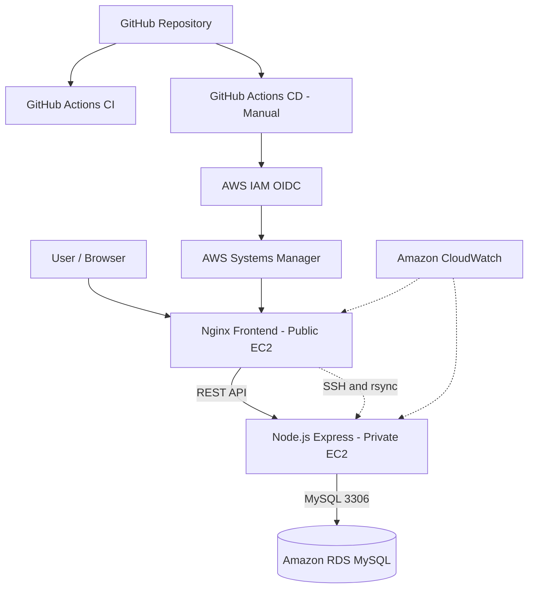

# AWS 3-Tier Architecture with DevOps CI/CD

A hands-on AWS Cloud and DevOps project demonstrating a secure three-tier application architecture, automated CI/CD pipelines, private backend deployment, and cloud infrastructure monitoring.

## Architecture

**Frontend → Backend → Database**

- **Presentation Tier:** Nginx web server hosted on a Public EC2 instance.
- **Application Tier:** Node.js and Express REST API hosted on a Private EC2 instance.
- **Database Tier:** Amazon RDS MySQL database.
- **Networking:** Custom Amazon VPC, public and private subnets, security groups, and controlled communication between tiers.

## Technologies

- **Cloud:** AWS EC2, VPC, RDS, IAM, Systems Manager, CloudWatch
- **Backend:** Node.js, Express.js
- **Database:** MySQL
- **Web Server:** Nginx
- **DevOps:** Git, GitHub, GitHub Actions, Docker, Bash, SSH
- **Operating System:** Ubuntu Linux

## CI/CD Pipeline

### Continuous Integration

GitHub Actions performs:

1. Repository checkout
2. Node.js environment setup
3. Dependency installation
4. JavaScript syntax validation
5. Docker image build

### Continuous Deployment

The manually triggered GitHub Actions CD workflow performs:

1. AWS authentication using GitHub OIDC and IAM roles
2. Remote command execution through AWS Systems Manager
3. Source code updates on the Public EC2 instance
4. Secure deployment to the Private EC2 instance through SSH and rsync
5. Production source backup
6. Backend service restart using systemd
7. API health verification
8. Automatic rollback attempt if deployment health checks fail

## Application Features

- REST API health endpoint
- Student records API
- MySQL database integration
- Nginx reverse proxy
- Private application server
- Automated backend deployment

## Monitoring

Basic Amazon CloudWatch monitoring is enabled for both EC2 instances, including:

- CPU utilization
- Network traffic
- Network packets
- CPU credit metrics

## Security

- Private backend EC2 without a public IP
- RDS database accessed through controlled security groups
- GitHub Actions authentication using AWS OIDC
- Dedicated deployment SSH key
- Environment variables excluded from Git
- Database credentials stored outside the repository

## Deployment Status

The application has been deployed and tested on AWS. GitHub Actions CI and manually triggered CD workflows have completed successfully.

## Future Improvements

- Automatic CD triggering after successful CI
- CloudWatch alarms and application logging
- Infrastructure as Code using Terraform
- HTTPS and domain configuration
- Expanded automated testing

## Author

Thushini Jayamaha

BSc Information Technology Undergraduate

GitHub: https://github.com/thushijayamaha	

## AWS Architecture Diagram

